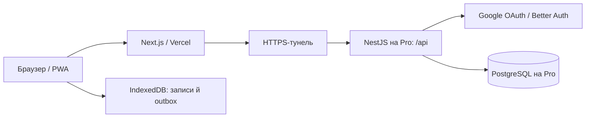

# Архітектура liftory

## Межі

Liftory — окремий продукт, Git-репозиторій, monorepo й набір образів. Next.js розміщується на Vercel, NestJS та PostgreSQL — на Intel Mac Pro. Home-server відповідає за Mac, тунель і операційні механізми. Його поточний автодеплой обслуговує лише demo home-server і не розгортає liftory автоматично.

Перший клієнт — адаптивний Web/PWA для iPhone і Mac. Native mobile, Telegram, AI, Redis/BullMQ та складна аналітика залишаються наступними етапами. Резервні копії відкладені власником; механізми backup не налаштовуються цим репозиторієм.

## Компоненти



Для браузера Web та API мають одну адресу Vercel. Next.js передає `/api/*` через публічний HTTPS-тунель до API на Pro. API сам перевіряє авторизацію; тунель не замінює контроль доступу. Серверний `APP_ORIGIN` та Google callback використовують адресу фронтенду. Секрети OAuth залишаються на Pro. PostgreSQL та майбутній Redis не публікуються через тунель. Деталі — у [плані розгортання](deployment.md).

```text
apps/web             UI, PWA, foreground sync
apps/api             авторизація, API, Drizzle schema, SQL migrations
packages/contracts   Zod-схеми, типи, канонічний формат даних
packages/offline     IndexedDB, локальні ревізії, outbox, sync engine
scripts              середовище та запуск local
tests                браузерні сценарії
```

## Продуктова модель

- **Exercise** — вправа з назвою, типом обладнання, групою м'язів і нотаткою. Конкретний тренажер можна уточнити в назві або нотатці.
- **WorkoutTemplate** — власний шаблон із порядком вправ і запланованими підходами.
- **Workout** — фактичне активне чи завершене тренування, час, нотатки, вправи та підходи.
- **WorkoutSet** — вага в кг або власна вага, цілі повторення, відмітка виконання.

Тренування містить snapshot назв і обладнання. Зміна вправи чи шаблону не переписує минулі результати. Архівація прибирає вправу з вибору та зберігає історію. Повторення тренування генерує нові UUID й скидає виконання підходів.

На сервері кожна сутність має власника, версію та час оновлення. Контракт даних однаковий на Web, у local store та API; сервер повторно перевіряє всі вхідні дані. PostgreSQL зберігає валідовані snapshots у JSONB, а окремі таблиці Better Auth — користувачів і сесії.

## Середовища

| Середовище | Призначення                       | Дані / запуск                                           |
| ---------- | --------------------------------- | ------------------------------------------------------- |
| local      | Розробка з незакоміченими змінами | Web/API з hot reload, окремий PostgreSQL у Compose      |
| dev        | Перевірка Vercel Web та AMD64 API | Стала dev-адреса Web, власні API, secrets і дані на Pro |
| prod       | Майбутнє особисте використання    | Окремі Web, конфігурація, дані та перевірка готовності  |

Git flow: `feature/* → develop → main`. Наявність гілки не створює runtime. Vercel доставляє Web, окремий workflow liftory доставлятиме API на Pro; цей CD ще не налаштований. Релізи liftory не змінюють demo home-server. Відкат образу не скасовує міграцію БД; зміни схеми спочатку перевіряються на dev.

## Перевірки

Контракти й offline state machine перевіряються unit-тестами. API перевіряє ізоляцію власників, повторні запити, конфлікти та реальні транзакції PostgreSQL. Браузерні сценарії перевіряють запис, reload та відновлення після offline. CI також перевіряє форматування, lint, TypeScript і збірки. Працездатність на фізичному iPhone та реальний Google OAuth фіксуються окремо від автоматичних тестів.
